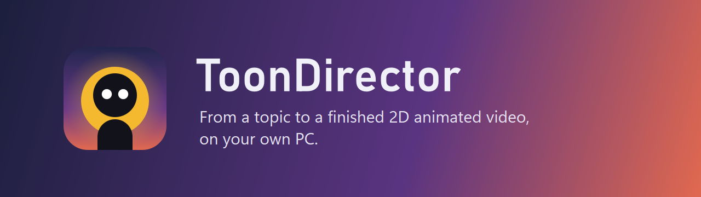
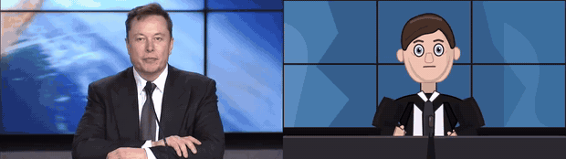
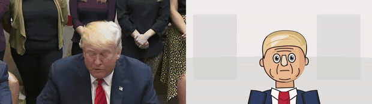
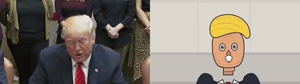
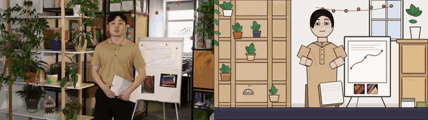
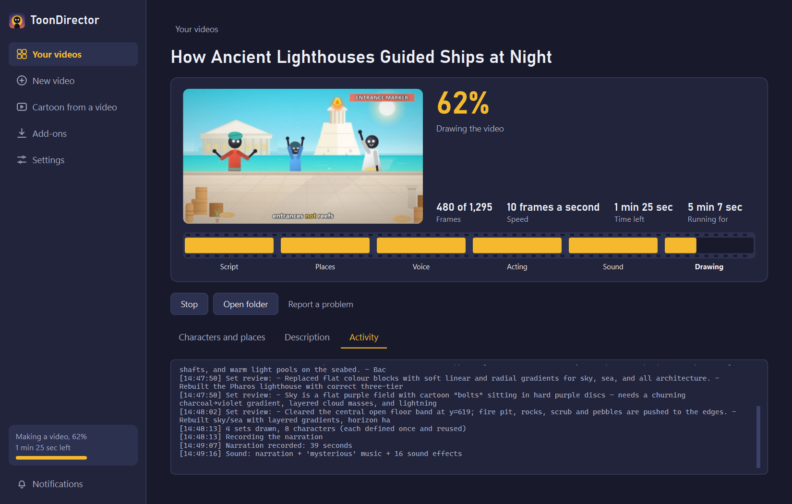

<p align="center"></p>

<p align="center">


</p>

<p align="center">
<a href="#see-it-work">See it work</a> ·
<a href="#features">Features</a> ·
<a href="#install">Install</a> ·
<a href="#ai-providers">AI providers</a> ·
<a href="#how-it-works">How it works</a> ·
<a href="#faq">FAQ</a>
</p>

ToonDirector researches your topic, writes the script, draws the places and characters, records the narration, acts out every scene and edits it all together with music, sound effects and captions. It can also redraw a video of your own as a 2D cartoon that keeps the original voice. Everything is drawn on your PC.

## See it work

Real video on the left, ToonDirector on the right.

| | |
|:-:|:-:|
|  |  |
|  |  |

Each clip was made from one short video, on a laptop with no graphics card. Versions with sound are in [`demo/clips`](demo/clips).

> [!NOTE]
> **These clips were made with DeepSeek (`deepseek-flash`), a fast, low-cost model.** ToonDirector uses the AI as its brain: it designs the characters, draws the places and directs the acting. The more capable the model you connect, the better the likeness, the richer the backgrounds and the more natural the acting.

Sources and permissions are listed in [`demo/CREDITS.md`](demo/CREDITS.md). The people shown have no connection to this project and do not endorse it.

## Features

### Make a new video
- **From a topic, your own script, or research notes.** It looks the topic up on Wikipedia, and the whole web with an optional Tavily key, then lists its sources in the video description.
- **Original art.** It draws up to 16 places and a recurring cast, with turbans, helmets, crowns, robes, crowds, camels and horses.
- **Acting.** Characters walk, gesture, react and breathe, in 20 poses and 8 moods.
- **Narration in 11 languages**, or in your own voice, converted on your PC.
- **Finishing.** It adds music, sound effects, titles, badges and word-by-word captions.
- **From 30 seconds to 60 minutes**, in wide YouTube or Shorts shape.

### Turn your own video into a cartoon
- Keeps the voice, and follows the face, mouth, head and body.
- Draws up to 8 characters and matching backgrounds with AI.

### Built for an ordinary PC
- Shows the newest frame as it is drawn, with speed and time left, also on the taskbar.
- Resumes stopped work where it left off.
- Works without a graphics card, and uses one for faster export when it can.
- Notifies you when a video finishes, keeps working from the tray, and keeps the PC awake while it works.

<p align="center"></p>

## Install

**You need:** Windows 10 or 11, [Python 3.12](https://www.python.org/downloads/), and an API key from any [supported provider](#ai-providers). Several are free.

```
git clone https://github.com/Maimuzamilhu/toondirector.git
cd toondirector
run.bat
```

The first start takes you through setup: choose where to keep your videos, connect an AI, and choose your downloads.

| Download | Size | Needed for |
|---|---|---|
| Video tools (FFmpeg) | 110 MB | Everything |
| Speech recognition | 150 MB | Cartoons from a video |
| Face and body tracking | 20 MB | Cartoons from a video |
| Lip-sync (Rhubarb) | 20 MB | Cartoons from a video |
| Use my voice (OpenVoice) | 1.3 GB | Narration in your own voice |

### Build the installer
```
.venv\Scripts\pyinstaller packaging\toondirector.spec --noconfirm
"C:\Program Files (x86)\Inno Setup 6\ISCC.exe" packaging\installer.iss
```

## AI providers

Add as many as you like in **Settings > AI providers**, and drag them into the order you want. If one runs out of credit or reaches its limit, the next takes over and the job keeps going.

| Free to start | Paid | On your PC |
|---|---|---|
| Groq, Google Gemini, OpenRouter, Cerebras, Mistral, SambaNova, NVIDIA NIM, Cohere | DeepSeek, OpenAI, Anthropic Claude, xAI Grok, Together AI | Ollama, LM Studio, any OpenAI-compatible server |

Drawing needs a model that writes good SVG code. For the best results, use a strong model that can also see images.

## How it works

```
topic ──► research ──► script ──► art direction ──► places + cast ──► narration
                                                                          │
   finished video ◄── captions, music, sound ◄── drawing every frame ◄── acting
```

| Folder | What it holds |
|---|---|
| `studio/` | The Windows app, built with Qt (PySide6) |
| `app/` | The video engine: providers, research, script, drawing, animation, export |
| `packaging/` | Installer and Microsoft Store build files |
| `demo/` | The clips above and the script that made them |

Every step is saved in the job's folder, so a stopped video continues from the last finished step.

## Speed

On an Intel i5 laptop with 8 GB of memory and no graphics card:

| Video | Time |
|---|---|
| 30 seconds at 720p | about 5 minutes |
| 15 minutes at 1080p | about 1.5 to 2.5 hours |

## FAQ

**Is it free?** The app is free and open source. You pay only your AI provider, and several have free tiers.

**Does it need the internet?** Yes for the AI and research, unless you run a model on your PC with Ollama or LM Studio. Drawing, voice conversion and export happen on your PC.

**Where are my keys stored?** In your data folder, in plain text. Keep that folder private.

**Why do characters look simple?** That is the explainer style. A stronger AI model gives more detailed people and places.

## Use it responsibly

Only use videos you own or have permission to use. Don't use ToonDirector to mislead people, impersonate anyone, or make someone appear to say something they didn't. Only use someone's voice with their permission. AI can get facts wrong, so check them before you publish.

## Contributing

Bug reports and pull requests are welcome. A new AI provider is usually one entry in `app/providers.py`.

## Licence

[MIT](LICENSE). FFmpeg, Rhubarb Lip Sync and OpenVoice are downloaded separately, under their own licences.
